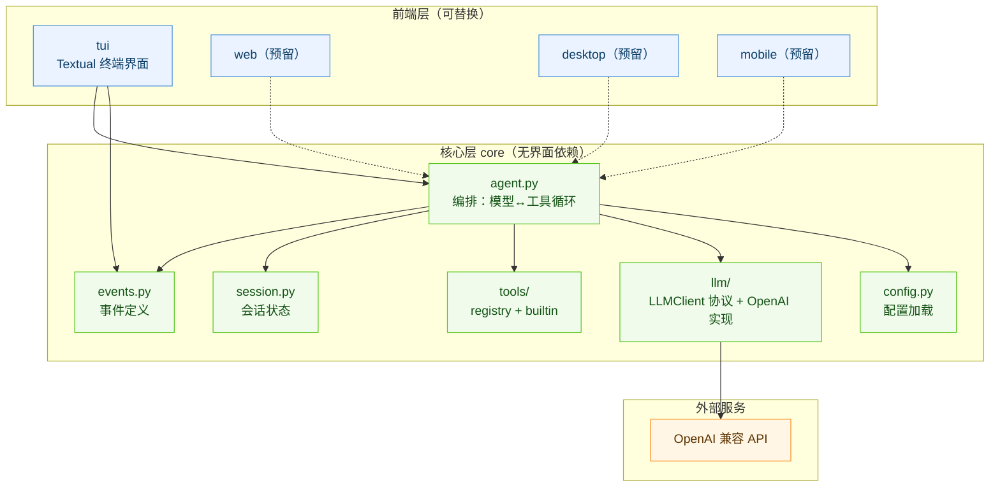
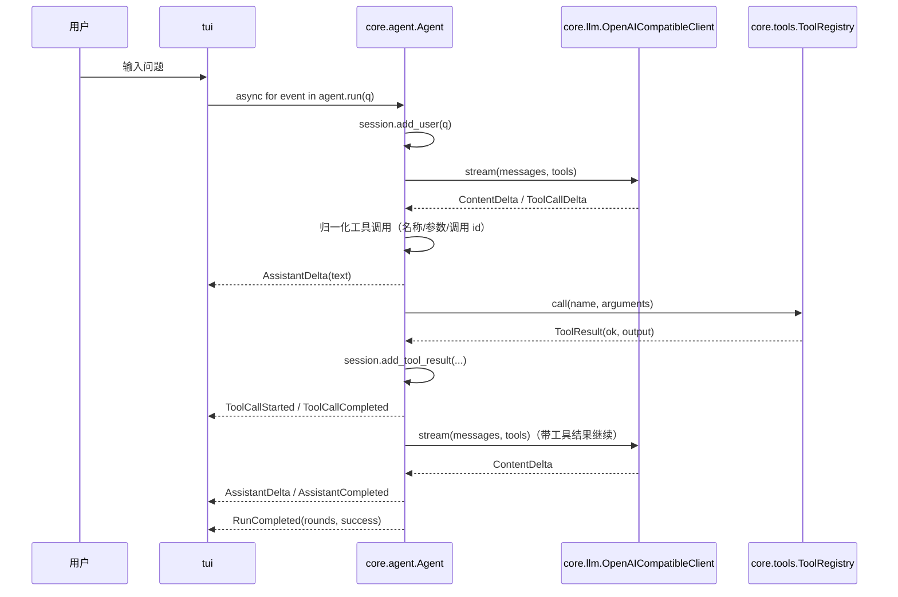

# xAgent 架构说明

## 1. 设计目标

1. **核心与界面分离**：`core` 不依赖任何界面框架，界面只消费事件；
2. **业务模块化**：配置、模型接入、工具、会话、编排各自成模块，单一职责；
3. **层级化**：上层可以依赖下层，下层不知道上层的存在；
4. **可替换**：模型服务商、工具集合、前端形态都可以替换而不动其他部分。

## 2. 分层与依赖

依赖规则：

- `core` 内部：`agent → session / tools / llm / events / config`（单向，无环）；
- `core` → 外部：只允许依赖 `httpx`；
- 前端 → `core`：只允许依赖 `core` 的公开 API；
- 前端之间：不允许互相导入。

## 3. 一次提问的完整时序

要点：

- 事件顺序即真实执行顺序，前端不需要额外同步；
- `ToolCallStarted` 与 `ToolCallCompleted` 通过 `call_id` 配对；
- 工具执行结果会写回会话，模型下一轮就能看到。

## 4. 核心模块职责

| 模块 | 职责 | 不负责 |
| --- | --- | --- |
| `core/config.py` | 读取 ini + 环境变量，产出不可变配置对象 | 不关心谁在用配置 |
| `core/models.py` | Message / ToolCall 定义与序列化 | 不含业务逻辑 |
| `core/events.py` | 定义对外事件类型 | 不负责派发 |
| `core/session.py` | 消息历史读写 | 不发起请求 |
| `core/llm/*` | 与模型服务通信（SSE 解析） | 不解析工具参数、不执行工具 |
| `core/tools/*` | 工具声明、参数校验、执行分发（兼容同步/异步） | 不关心对话流程 |
| `core/agent.py` | 编排"模型 → 工具 → 模型"循环，产出事件 | 不渲染、不打印 |
| `core/factory.py` | 组装 Agent（唯一的组装入口） | 不含业务规则 |
| `tui/*` | 渲染事件、收集输入、处理斜杠命令 | 不调用模型、不执行工具 |

## 5. 关键设计取舍

| 取舍 | 原因 |
| --- | --- |
| 核心层用**异步生成器**而非回调 | 同一套代码可同时服务 Textual（asyncio）、FastAPI（SSE）与桌面端事件循环 |
| 事件用**dataclass** 而非 Pydantic | 核心层保持零额外依赖；需要 JSON 时用 `dataclasses.asdict` 即可 |
| 工具参数**统一在注册中心校验** | 避免每个工具各写一套；错误以文本回传模型，模型可自行重试 |
| 工具异常**不向上抛出** | 保证一次工具失败不会中断整轮对话 |
| 网络类工具用**异步处理器** + `acall` | 网络请求与阻塞式 `curl`/解析不阻塞 TUI 等前端的事件循环 |
| 流式解析用 `raw_decode` | 容忍模型返回的 `arguments` 尾部碎片 |
| 工具调用先归一化再回传 | 部分服务商把整段调用塞进 `arguments`、或缺调用 id；不归一化会导致回传消息缺字段而直接 400 |
| 界面层用 Rich `Markdown` 而非 Textual `Markdown` | 前者可以同步替换内容，避免与组件挂载产生竞态 |

## 6. 扩展点速查

| 需求 | 落点 |
| --- | --- |
| 新增工具 | `core/tools/builtin/` 加文件，或运行时 `agent.register_tools([...])` |
| 新增模型服务商 | 实现 `core.llm.client.LLMClient`，`build_agent(client=...)` 注入 |
| 新增前端 | 新建目录，只依赖 `core`；见 `docs/FRONTEND_CONTRACT.md` |
| 修改系统提示词 | `config.ini` 的 `[agent] system_prompt` |
| 调整流式刷新节奏 | `tui/app.py` 的 `FLUSH_INTERVAL` |
| 增加会话管理 | `core/session.py` 的 `Session`，按用户 id 映射即可 |
